# LoRa protocol, companion device and Android app

Date: 2026-10-21, revision 2 on 2026-10-22 (addresses
`2026-10-21-lora-protocol-companion-app-review.md`; the finding ids P0-n, Rn, Sn, Tn, Hn, An, P2-n
are that review's).
Status: design approved, implementation plan not written yet.
Replaces the "Radio protocol" section and milestones 4 and 7 of
`2026-09-28-esp32-lora-carrier-design.md`. Numbers marked EST are guesses until measured.

## Goal

- Field devices (Airsoftcoin counters, the rotating flag, later respawn points, bombs, ...) report to
  and are controlled from **one organizer phone**.
- The phone talks **BLE** to a **companion**: a Heltec V4.3 with OLED that bridges to LoRa.
- **Star with a 1-hop relay**: 1-2 devices act as relays for an app-set list of devices out of reach.
- Up to **~10 field devices** per game; the address space allows 254.
- App v1: live device list, game control, GPS map (offline), capture log + per-player stats + export.
- Every device keeps a **persistent event log** in flash; the game can be replayed from it, and gaps
  are filled over LoRa.
- Games keep running on the devices when the radio, companion or phone is gone. The radio only
  reports and commands.

### Design point (P0-6)

The channel is sized against these numbers; the simulator (Part 8) checks them.

| Quantity | Design point |
|---|---|
| Field devices | 10 |
| Events | **≤ 600 / h network-wide** (≈ 60 / h per device) |
| STATUS | every 30 s per device, no extra STATUS on state change (the EVENT carries the change) |
| Relays | ≤ 2, each serving ≤ 8 devices from an app-set allowlist; a device is on at most one list |
| Spreading factor | SF9 (a network constant, Part 1) |

## Decisions (and what was rejected)

| Topic | Chosen | Rejected |
|---|---|---|
| Companion link | V4 + BLE GATT | USB-OTG serial (cable), WiFi AP (phone loses internet, more power), Meshtastic (fights game control) |
| Topology | Star + 1-hop relay | Single star (range), several companions (command authority) |
| Channel access | CAD listen-before-talk + allowlisted relays | Companion polling, GPS TDMA, relays that forward everything (a relay that hears the whole field hits its 10 % cap) |
| ACK strategy | One ACK per EVENT, sized for 600 events / h | Batched/cumulative ACKs (later, if the simulator or the field needs them) |
| App | Kotlin + Compose, hand-written codec + shared golden vectors | Rust core via uniffi (NDK build), Flutter |
| Keys | App generates; typed into each device's WiFi page; companion gets it over a **paired, encrypted** BLE link | LoRa pairing (sniffable), compiled-in key, key over an unpaired BLE link (P0-1) |
| BLE security | LE Secure Connections passkey (OLED shows, phone types) + bonding; app-level ECDH + committed SAS as a specified fallback; HMAC-SHA256 mutual AUTH on top | Unpaired link + one-way HMAC (P0-1/P0-2), accepted risk |
| Full log dump | LoRa only (`LOG_GET`) | WiFi page download, BLE on every device |
| Companion off | PRG soft off (deep sleep) + inline key switch | Hard switch only |
| Companion cell | Protected LiPo pouch Akyga AKU-06034 (2200 mAh, 59 × 37 × 9 mm) | Bare cell (P0-3), 18650 (does not fit the case, H1) |
| Device key storage | Plain flash; rekey on loss | Flash encryption + secure boot (explicitly denied: eFuse burns, brick risk) |
| LoRa AES | Software `aes` + `ccm` | S3 hardware AES (no CCM mode, no measurable gain) |
| BLE MTU | Require ≥ 247 granted, refuse otherwise | App-level chunking |

## Part 1: Architecture and LoRa frame

```
 Android app ──BLE (paired)──> Companion (V4.3 + OLED) ──LoRa 869.525──> field devices (counter, flag, ...)
 (UI, game log,               (crypto, ctr, retries,                    (game runs locally; flash log;
  map, key gen)                dedupe, buffering)                        reports + takes commands)
                                                          ▲
                                         relay device(s) forward allowlisted frames once
```

Code layout:

- `firmware/core/src/proto.rs` (`asg_core::proto`; the carrier plan's `asg-core::protocol` is renamed
  to match): frame codec, AES-CCM, replay windows, airtime tracker, retry state, relay decision, log
  record and log index. no_std, host-tested.
- `firmware/device/src/bin/companion.rs` behind a `companion` feature (`required-features`), with its
  own pin map `board/companion.rs` next to `board/carrier.rs` (T8: the carrier map's GPIO21 is I2S,
  the companion's is OLED RST).
- `android/`: the app.
- `docs/protocol.md`: the living wire spec. P1 starts by moving Part 2's tables and the appendix
  (enums) there.
- `proto/vectors.json`: golden vectors shared by the Rust and Kotlin tests (frames, BLE messages, log
  folds).

### Radio

- 869.525 MHz (g3 sub-band 869.4-869.65, 10 % duty, ≤ 500 mW ERP), SF9, BW125, CR4/5, explicit
  header, CRC on, 8-symbol preamble.
- **SF is a network constant** (R10): it is part of the network config together with `net_id` and
  the key (entered on each device's WiFi page and in `SET_NET`). There is no over-the-air SF change;
  changing SF is the rekey procedure (Part 6).
- **TX power, two numbers (R7):** firmware clamps the **conducted** setpoint to
  `29.15 dBm − antenna_gain_dBi` (500 mW ERP = 27 dBm ERP = 29.15 dBm EIRP). With the carrier's
  3.6 dBi antenna that is **25.5 dBm conducted**. `antenna_gain_dBi` is a common CONFIG param (and a
  companion setting); default conducted setpoint 20 dBm.
- **Duty cycle (R5, R8):** every node keeps a sliding 1 h window of its own airtime (60 one-minute
  buckets of used ms). Limit 10 % (360 s / h); LOG frames only while the window is under 7 % (252 s).
  The window total is persisted on shutdown and every 10 min; after a boot (no RTC) the persisted
  total is charged to the first minute bucket, so a reboot never resets the budget.

### Frame (little-endian)

| Bytes | Field | Notes |
|---|---|---|
| 1 | `net_id` | cheap filter before any crypto (random, from the app; a foreign network collides with p = 1/256 and only costs a failed tag check) |
| 1 | `hop` | 0 = original, 1 = relayed. **Not authenticated** (S4), so relays never re-encrypt |
| 1 | `src` | 0 = companion, 1-254 = devices |
| 1 | `dst` | 0 = companion, 1-254 = devices; 0xFF reserved (no message uses broadcast) |
| 4 | `ctr` | per-sender frame counter |
| 1 | `type` | message class (7 bits) + ACK-request bit 0x80 |
| n | payload | AES-CCM encrypted |
| 4 | tag | CCM MIC |

Overhead 13 B. Max LoRa payload 255 B.

- **Crypto:** AES-128-CCM (t = 4, n = 13, L = 2), one network key. Nonce = `net_id | src | ctr`,
  zero-padded to 13 B. AAD = header without `hop`. A 4 B tag is ~1 in 4·10⁹ per forgery try against a
  duty-limited channel (LoRaWAN uses the same MIC size).
- **`hop` is unauthenticated (S4, P2-7):** a keyless attacker can flip it and suppress one relay
  copy. Nothing uses `hop` for a security decision; the app labels relayed devices "via relay" as
  telemetry only.
- **Software AES** (RustCrypto `aes` + `ccm`), the same code in host tests and on the device. The S3's
  AES accelerator is not used: CCM is not a hardware mode, and ~30 block ops per 239 B frame take tens
  of µs against 1189 ms airtime. `ponytail:` software AES; put esp-hal's hardware AES behind the same
  trait if profiling ever shows crypto.
- **Key storage: flash encryption and secure boot are explicitly NOT used** (user decision 2026-10-21:
  one-way eFuse burns that complicate reflashing and can brick boards). Consequence: anyone holding a
  device can read the network key with `esptool`. Mitigation: the rekey procedure (Part 6).

### Counters and replay (S1, S2, R3)

- **Invariant:** `ctr` never repeats while `(net_id, key, src)` is unchanged. Anything that can erase
  a `ctr` (reflash, factory reset, replacing a device under the same `src`) requires a **new key and
  new `net_id`** (the rekey procedure).
- `ctr` starts at a random 32-bit value on first provisioning, is persisted every 256 frames and on
  clean shutdown, and skips ahead **512** (2 × the persist interval) on boot.
- **Device → anyone:** receivers keep, per `src`, the highest `ctr` + a 32-bit bitmap (relayed copies
  arrive out of order). The bitmap also drops relay duplicates, since a relay keeps `ctr` unchanged.
- **Companion → device (R3): strict high-water, no bitmap.** A device accepts a companion frame only
  if its `ctr` is above the last accepted one; the high-water is persisted on every accepted command
  (commands are rare). A late START retry can therefore never arrive after the STOP that followed it.
- **Companion windows (S2):** the companion persists each `src`'s high-water every 10 min and on
  shutdown, and after a reboot accepts only frames above it. The app additionally rejects a STATUS
  whose `last_event_id` or `game_s` goes backwards within a boot.
- The companion flags a **duplicate `src`** (two different `kind`s, or boot records interleaving) in
  `INFO` and the app shows it.

### Device kinds and extensibility

`type` is the message class only (13 used of 128, appendix). Device and event kinds live in the
payload:

- STATUS starts with `kind u8` (counter, flag, respawn, bomb, ...).
- Log records carry `event u8` (capture, block mined, flag captured, respawn used, ...).
- CONFIG carries `(param_id u8, value i32)` pairs: ids 0-31 common to all kinds, 32+ kind-specific.

The companion forwards STATUS / EVENT / LOG / CONFIG by class and never parses kind-specific bytes, so a
**new device kind needs no companion update**: only its firmware and the app's kind table.

## Part 2: Message catalogue

Airtime at SF9 / 125 kHz (SF10 in brackets). Exact enum values are in the appendix.

### Device → companion

| type | Payload | Frame | Airtime |
|---|---|---|---|
| `STATUS` | common 22 B + kind tail 6 B | 41 B | 287.7 ms (534.5) |
| `EVENT` (ACK req) | `game_id u16` + log record 14 B | 29 B | 226.3 ms (411.6) |
| `ACK` | `acked_ctr u32, result u8, detail u8` | 19 B | 185.3 ms (329.7) |
| `LOG` (answers `LOG_GET`) | `game_id u16` + 0-16 log records | ≤ 239 B | 16 rec: 1188.9 ms (2132.0) |
| `CONFIG` (answers `CONFIG_GET`) | up to 8 × `(param_id u8, value i32)` | ≤ 53 B | ≤ 328.7 ms (616.4) |

STATUS common part (22 B): `kind u8 · state u8 · flags u8 · batt_mV u16 · game_id u16 · game_s u16 ·
lat i32 · lon i32 · gps_age_s u8 · rssi i8 · snr i8 · last_event_id u16`

- `state` (generic, per-kind mapping in the appendix): idle / ready / running / ended / fault.
  `flags`: relay on, GPS fix, low battery, fault, game override (FLAG), config changed since boot,
  time valid (Time sync).
- `game_id` (R1): the device's current game (0 = none), so the app never compares one game's log with
  another's tail. +2 B always (simpler than an optional field; +0.7 % channel).
- `game_s` (P2-11) wraps at 18.2 h; the app unwraps it with its receive time.
- `lat`/`lon` in 1e-7 °. `rssi`/`snr` = last companion frame as heard by the device; the companion
  adds its own reading when forwarding. For a relayed device the companion's reading is the relay's
  (P2-6): the app labels it "via relay".
- `last_event_id` is the newest record in the device's log; with it the app finds every hole,
  including at the tail (P2-3).
- **One fault field (P2-10):** the `flags` fault bit says "look"; the kind tail says what. The mining
  countdown is not in STATUS (the app derives it from the last capture and the config).

Kind tails: counter `red u16 · blue u16 · left u16`; flag `pos u8 · fault u8 · red_hold_s u16 ·
blue_hold_s u16`.

### Companion → device (all ACK requested, all unicast)

| type | Payload | Frame | Airtime |
|---|---|---|---|
| `PING` | none; answered by ACK, then the device queues a STATUS (P2-2) | 13 B | 164.9 ms (288.8) |
| `START` | `game_id u16, start_in_ms i32, mode u8, unix_s u32, ms u16` | 26 B | 205.8 ms (411.6) |
| `STOP`, `RESET` | none | 13 B | 164.9 ms (288.8) |
| `CONFIG` | up to 8 × `(param_id u8, value i32)` | ≤ 53 B | ≤ 328.7 ms (616.4) |
| `CONFIG_GET` (R11) | up to 8 × `param_id u8`; empty = all | ≤ 21 B | ≤ 185.3 ms (370.7) |
| `FLAG` | R / N / B / AUTO | 14 B | 164.9 ms (288.8) |
| `TIME` | `unix_s u32, ms u16` | 19 B | 185.3 ms (329.7) |
| `LOG_GET` | `from_id u16, count u8` (1-16) | 16 B | 164.9 ms (329.7) |

- **Every command is unicast** (R9); `dst = 0xFF` is unused. START, STOP and RESET to N devices are N
  commands; the app shows per-device results, re-sends to the failed ones, and the next STATUS
  reconciles.
- **STOP vs RESET (P2-17):** STOP ends the game (state ended, scores kept, log segment closed with a
  `GAME_END` record). RESET returns to idle, clears scores, closes the segment. START for a *different*
  `game_id` while running → `ACK{busy}`; START for the running game → `ACK{ok}` (idempotent).
- Common CONFIG params (ids 0-31): relay on/off, relay allowlist (8 ids), TX power, antenna gain,
  STATUS interval, START grace, log records per frame. Kind params from 32.

### START timing (P0-4)

- The app sends one `SEND START` per device with the **same `game_id`** and a countdown. The companion
  fixes **one deadline T per `game_id`** when the first of them arrives (T = arrival + countdown) and
  reuses it for the rest, echoing T in each `RESULT`.
- On every attempt the companion sets `start_in_ms = T − now` as a **signed** `i32`. A negative value
  means "late by that much": the device starts at once and **backdates its game clock**, so every
  device's game time still agrees.
- A device rejects a START later than its `START grace` (common param, default 30 s) with
  `ACK{late, detail = late seconds}`; the app shows it as failed.
- The app enforces a countdown ≥ `N_devices × 1 s + 5 s`.
- **Why not several commands in the air at once:** the radio is half-duplex. A companion that sends
  the next command while an ACK is due misses the ACK. Commands are stop-and-wait (≈ 0.45 s each when
  direct), but a device that is in backoff does not block the others: the companion serves whichever
  command is due next. START-all to 10 healthy devices ≈ 4.5 s; failed attempts cost 2.5 s each.

### Time sync

Games never use wall-clock time (START is relative, every game timer is relative), so a wrong clock
cannot break a game. UTC only puts log records on a real timeline (event log, stats, CSV).

- **Source: the phone** (network / GPS time). The app sends `unix_ms` in `AUTH` and a BLE `TIME`
  every 10 min while connected. The companion runs on its 40 MHz crystal (≤ ±36 ms / h) between
  updates. After a reboot without a phone it has **no time** and sends none.
- **START carries the companion's time** (`unix_s, ms`, +6 B, +20 ms airtime), so every device in a
  game is synced at the start.
- **`TIME` command** for devices outside a game: when a STATUS arrives with the *time valid* flag
  clear, the companion sends one `TIME` (ACKed, unicast); then again every 6 h per device for drift.
- **Stamping and correction:** the companion fills in the time after CAD succeeds, just before TX
  (on every attempt). The device takes `t_tx_start = rx_done − airtime(len, SF)`; LoRa airtime is
  deterministic, so a direct frame is accurate to a few ms. A relayed copy (`hop = 1`) carries the
  relay's random 50-300 ms + CAD delay: it is accepted as **coarse** (± 0.5 s).
- **Priority on the device:** GPS > companion direct > companion via relay. A worse source is ignored
  while a better anchor from the same boot is younger than 6 h; a better one replaces it at once.
  `time valid` = any anchor in this boot.
- **Logged as `TIME_ANCHOR`** (Part 3) whenever an anchor is taken: first GPS fix, then hourly while
  GPS holds; every accepted companion time.
- `Not doing:` a periodic broadcast time beacon (airtime nobody needs).

### Channel load at the design point (P0-6)

| Traffic | Arithmetic | Channel |
|---|---|---|
| STATUS | 10 × 287.7 ms / 30 s | 9.6 % |
| EVENT + ACK | 600 / h × (226.3 + 185.3) ms | 6.9 % |
| Relay copies (≈ 3 allowlisted devices) | their STATUS + 30 % of EVENT/ACK | ≈ 4.9 % |
| Commands, PING, CONFIG | occasional | < 0.5 % |
| **Total** | | **≈ 22 %** |

Per node: a device ≈ 1.2 %, the companion ≈ 3.1 % (its ACKs), a relay with 3 devices ≈ 6 %. All under
10 %, with headroom for gap-fill. At SF10 every figure roughly doubles: raise the STATUS interval to
60 s and keep the event design point.

### Queue priority (P2-15)

ACK > command > EVENT > relay copy > LOG > STATUS. When a budget or the channel is short, STATUS is
dropped first (the next one replaces it).

## Part 3: Device event log

- **Every state change is a record, appended to flash before it is sent:** game START, STOP, RESET,
  config changes, captures, blocks mined, flag moves, power-on, low battery, faults, admin card
  actions, shutdown. Folding a game's records rebuilds its score; the app checks that against STATUS.
- **Record (14 B, identical in flash and on air):** `event_id u16 · t_ms u32 · event u8 · team u8 ·
  player u16 · extra[4]`. No extra CRC (P2-9): `sequential-storage` already CRCs each item and pads it
  to 16 B + an 8 B header = **24 B in flash**.
- **`event_id` (A2):** a per-device counter that **never resets** (not per game, not per boot). It
  wraps at 65 536; the flash ring holds far fewer records, so ordering is unambiguous.
  `ponytail:` the app's key `(dev, event_id)` collides after 65 536 events from one device (years of
  play); add a wrap epoch if that ever matters.
- **`t_ms` (R2):** milliseconds since boot. A power cut loses the outage duration; nothing can recover
  it without an RTC.

### Segments: game identity in the log (P0-5)

Records are grouped by header records, so the 14 B record and 16 records per LOG frame stay:

| Header record | `extra[4]` | Meaning |
|---|---|---|
| `BOOT` | `boot_seq u16 · fw_ver u8 · proto_ver u8` | new `t_ms` origin; records after it until the next `BOOT` share it |
| `TIME_ANCHOR` | `unix_s u32` (`team` = source: 0 GPS, 1 companion direct, 2 via relay; `player` = ms) | UTC at this record's `t_ms` (Time sync, Part 2) |
| `GAME_START` | `game_id u16 · mode u8 · flags u8` | opens a game segment; following records belong to `game_id` |
| `GAME_END` | `game_id u16 · reason u8 · 0` | closes it (STOP, RESET) |

- A record belongs to the game of the nearest `GAME_START` before it with no `GAME_END` in between;
  otherwise to game 0 ("no game").
- EVENT and LOG frames carry the `game_id` of their (first) record's segment, so the app can file
  live records without the header; LOG frames that span a header carry it inside.
- **`game_id` (R13)** is a random non-zero u16 from the app (`SecureRandom`), not a sequence, so an app
  reinstall cannot reuse an id still in some device's flash.
- **Reboot in a game (R2):** on boot the device scans the log tail. If a game segment is open, it logs
  `BOOT`, resumes the game with its game clock at the last logged game time (the outage is not
  counted), and an interrupted mining interval counts as elapsed (back to ready). The next STATUS
  shows `game_id` and the `BOOT` record tells the app what happened.

### Storage (R6, T4, T5, P2-12)

- A dedicated `asg_log` partition of **384 KB** (96 sectors of 4 KB) ≈ **16 000 records** at 24 B.
  Append-only ring through `sequential-storage`'s `queue` (pop-before-push when full). Verify its
  iterate-without-pop API in the plan before writing anything custom.
- **Persistent:** survives reboots, crashes and battery swaps. Records go only when the ring wraps
  (oldest first) or on an explicit "Wyczyść log" in the admin menu (admin card). STOP and RESET never
  clear it.
- **Power cuts:** each record is written immediately; at most the record being written is lost. The
  crate's CRC rejects a torn last item.
- **Wear:** each sector is erased once per ~16 000 records; negligible against ~100 k cycles.
- **Index:** at boot the device builds a RAM index of the first `event_id` in each sector (96 × 2 B),
  so `LOG_GET` reads one or two sectors instead of scanning the ring with the radio waiting.
- **Flash writes stall the CPU** (cache off, PSRAM and non-IRAM ISRs blocked; `esp-storage` uses a
  4 KB stack buffer): no radio or BLE buffers in PSRAM, log task stack ≥ 12 KB, records written with
  an aligned buffer. The plan measures the write and erase stalls against the 2.5 s ACK timeout and
  the BLE connection interval.

### Gap-fill and full dumps (LoRa only; R4, R5, R14, P2-4, P2-5)

- `LOG_GET{from_id, count}` returns the records from `from_id` on, in one `LOG` frame:
  - from_id older than the oldest record still in flash → the reply starts at the oldest one; the app
    marks the skipped range "lost (log wrapped)" and stops asking for it;
  - from_id past `last_event_id` → a `LOG` with 0 records.
- **Records per frame** is a common CONFIG param (1-16, default 16). 17 would fit LoRa (253 B) but not
  the BLE `RX` message (P2-5 vs T6). The field test measures 8 / 12 / 16, because a long frame collides
  more on a busy channel.
- **Stop-and-wait with retry:** one `LOG_GET` in flight; the `LOG` reply is its ACK. Timeout = 2.5 s +
  2 × LOG airtime (≈ 4.9 s at 16 records, covers a relayed reply); 3 attempts with new `ctr`s, then
  `RESULT{timeout}` and the app retries later. A repeated `LOG_GET` returns the same records.
- **Lowest priority:** a device answers only while its window is under 7 %; otherwise
  `ACK{busy, detail = retry s}`.

| Dump | Frames (16 rec) | Airtime | Wall time at 7 % |
|---|---|---|---|
| A typical 8 h game, ≈ 480 events | 30 | 35.7 s | ≈ 8.5 min |
| 1 000 events | 63 | 74.9 s | ≈ 17.8 min |

Relayed devices cost double channel airtime; the app shows the longer ETA. Gap-fill of small holes runs
during a game; full dumps are suggested after STOP.

## Part 4: Reliability and relay rules

Channel access (all nodes):

- **CAD before every TX** (~8 ms at SF9). Busy: random 100-600 ms backoff, up to 8 tries; then a STATUS
  is dropped and anything else is requeued.
- **The duty window has the last word:** a frame that would exceed 10 % (7 % for LOG) waits.

ACKs and retries:

- The receiver ACKs after CAD + random 20-100 ms.
- **ACK timeout 2.5 s fixed** (worst path: frame → relay delay → copy → ACK → relay delay → copy
  ≈ 1.5 s + slack).
- **Commands:** 4 attempts. The next attempt starts after the ACK timeout plus a backoff of 2 / 4 / 8 s
  + jitter (P2-16), then `RESULT{timeout}` to the app.
- **EVENTs:** retried forever, same rule, backoff doubling 2 s → 60 s cap. RAM queue of 32; on overflow
  the newest stay only in flash and gap-fill brings them. **A capture is never lost, only late.**
- **A retry is a new frame with a new `ctr`** (the same `ctr` would hit the replay window and never be
  re-ACKed if only the ACK was lost). The sender accepts an ACK for any `ctr` of its attempts.
- **Handlers are idempotent:** START for the running game ACKs; STOP, RESET, CONFIG, FLAG, LOG_GET
  repeat harmlessly; EVENTs dedupe on `(dev, event_id)`.

Relay rules (common CONFIG: `relay = 1` + allowlist of ≤ 8 device ids):

- The app builds the allowlists from what the companion does **not** hear directly (STATUS that only
  ever arrive with `hop = 1`, or not at all), and puts each device on **at most one** relay's list.
- A relay forwards a frame when `net_id` matches, `hop = 0`, the tag is valid, **`src` or `dst` is on
  its allowlist**, and the frame is new to its replay window.
- Set `hop = 1`, wait random 50-300 ms, CAD, send.
- Relayed copies keep `ctr`, so every node's replay window drops the second copy.
- **No relay-to-relay suppression (R12):** with each device on one list, two relays never carry the
  same frame. The previous suppression rule is deleted.
- **Half-duplex (P2-8):** a relay misses what arrives while it transmits (its own ~6 % TX). Retries
  cover it; the simulator includes it.

Degraded modes:

| Situation | Behaviour |
|---|---|
| Companion out of range / off | Games run on. STATUS keeps its schedule. EVENT retries slow to 60 s. On return the queue drains and gap-fill closes holes. |
| Phone disconnected from companion | The companion still ACKs on LoRa and buffers frames for the app (RAM ring, 256 entries); replays them on reconnect. Overflow is recovered by gap-fill. |
| Companion reboots | Own `ctr` resumes with skip-ahead; per-`src` windows resume from their persisted high-water (S2). |
| Device reboots mid-game | Resumes from the flash log (Part 3), logs `BOOT`. |

RX: devices listen continuously (~5 mA SX1262). `ponytail:` SX1262 duty-cycled RX needs a longer
preamble; consider it in carrier task C8 if `power_budget.py` says the weekend is tight.

## Part 5: Companion

### Hardware

- **Heltec WiFi LoRa 32 V4.3 with OLED** (H7). On a V4.2, `Vext` also feeds the GC1109 front end,
  so turning the OLED off would kill the radio; the V4.3 (KCT8103L) has its own `Vfem` (GPIO7). The
  firmware reads the revision and refuses to cut `Vext` on a V4.2. The OLED is an **SSD1315**
  (SSD1306-compatible; the `ssd1306` crate works) on SDA 17, SCL 18, RST 21, powered from `Vext`
  (GPIO36 on R2, GPIO40 on R8).
- **Cell (P0-3, H1): Akyga AKU-06034**, Li-Po 1S 2200 mAh, 59 × 37 × 9 mm, 41 g, 4.2 V charge,
  **protected** (built-in PCM, user's choice). Its datasheet gives no PCM thresholds or current limits:
  - on arrival, confirm the PCM under the tape at the leads;
  - bench: a short across the leads trips the PCM; record the overcurrent trip;
  - fit: 9 mm in the back-shell bay (~12 mm), clear of the key switch (only ≤ 5 mm fits under it);
    check against `hardware/companion/modify_case.py`'s envelope.
  - `ponytail:` no extra PTC, the PCM covers shorts; add a 1.5 A PTC in the + lead if the PCM cannot be
    confirmed.
- **Battery connector:** Molex PicoBlade 1.25 mm (not JST SH), rated 1 A. The ~1 A peaks quoted for
  27 dBm do not occur here: the setpoint is ≤ 25.5 dBm and 20 dBm by default, RMS ≈ 0.14 A.
- **Key switch (H2, H3):** the housing, the switch (Blow SWT-06357) and its double-D hole are in
  `2026-10-21-companion-key-switch-design.md` and its plan. Requirement for the part: a **documented
  ≥ 1 A DC rating at 3.7 V** (2 A preferred), or a hot-switch bench test at 1 A before it is used. OFF =
  0 µA, for storage, transport and a firmware hang RST does not cure. OFF with USB in: the board runs
  from USB, the cell is not charged, and the battery node sits at the charger's 4.2 V with no cell
  (firmware would read "full"; P2-21).
- **Antenna (R7, P2-24):** an 868 MHz antenna on SMA through the case's 13.5 mm antenna bay, u.FL-SMA
  pigtail. Its gain goes into the companion's `antenna_gain_dBi` setting, which sets the TX clamp.
  Part chosen in the plan.
- The case is printed (third-party mesh, modified by `modify_case.py`) and not IP-rated. Check that
  both PRG and RST are reachable (RST may need a pinhole).
- Onboard LED: slow blink = no phone, steady = phone authenticated, fast blink = setup/pairing.

### Buttons (H9, P2-22)

Thresholds: short < 1 s, hold ≥ 3 s (the OLED counts it down; release cancels).

| State | Short press | Hold 3 s |
|---|---|---|
| Deep sleep | wake (also RST) | wake |
| OLED off | OLED on, same page as last time (does not advance) | as on the page shown |
| OLED on, normal page | next page | **off**: `Wyłączanie… 3 2 1`, `SHUTDOWN` event, save `ctr`, windows and duty, `Vext`/`Vfem`/SX1262 off, deep sleep |
| OLED on, Setup page | next page | open the 60 s pairing window |
| Pairing window open | cancel the window | cancel the window |

- The pairing window closes on success, on cancel, after 60 s, or when the phone disconnects.
- RST = hard reboot. PRG held while pressing RST enters USB download mode (harmless, RST again);
  noted in the manual.
- **Bench check:** waking from deep sleep with PRG does not latch download mode.
- **Deep sleep at 20 µA (P2-20)** needs `Vext` and `Vfem` (GPIO7) off, the SX1262 in sleep and
  `ADC_Ctrl` (GPIO37, R2 only) off so the battery divider draws nothing.

### UVLO (H4)

- Threshold **3.60 V**, release 3.70 V, measured as the median of 8 readings with the radio idle (a TX
  burst sags the rail).
- On UVLO: `BATERIA!`, `SHUTDOWN{low_batt}`, deep sleep with a **30 min timer wake**. Each timer wake
  measures again and goes back to sleep unless the cell is above 3.70 V, so a companion left on a power
  bank comes back by itself. There is no VBUS-detect pin; the timer replaces it.
- At 20 µA the 2200 mAh cell with ~5 % left takes about 7 months to empty.

### OLED pages (Polish, like the field LCDs)

| Page | Contents |
|---|---|
| 1 Overview | phone ✓/✗, battery % + mV, game state + time, devices online `7/9`, airtime used % |
| 2 Devices | one line each: `D3 C RUN 12s -97` (id, kind letter, state, last seen, RSSI); with more than 6 the list **scrolls by itself every 3 s** (H9), so every device is reachable without the phone |
| 3 Events | last 6: `12:03 D3 PRZEJ R p17` |
| 4 Radio | SF, TX dBm conducted, TX/RX counts, queue depth, CAD-busy %, duty % |
| Setup | `net_id`, 4-hex key fingerprint (the app shows the same one; a typo check, not a security check), `przytrzymaj: PAROWANIE` |
| Pairing (window open) | the 6-digit passkey or SAS, `PAROWANIE 58s` |

- Off by default; a button press wakes it for 30 s. Off means `Vext` off, 0 mA. Waking on events is a
  config flag.
- Read-only. `Skipped:` game control from the companion alone (STOP-all menu); add if a dead phone
  mid-game becomes a real problem.
- Drivers: `ssd1306` + `embedded-graphics` (check async / embedded-hal 1.0 support in the plan).
- Short labels shared by OLED, field LCD and app (A4): `CZ` / `NIE` (teams), `GOT` / `GRA` / `KON`
  (ready / running / ended), `PRZEJ` (capture).

### Battery life (EST; add a `--companion` mode to `hardware/power_budget.py`)

Assumes the design point (≈ 600 ACKs + commands per hour, ~3 % TX duty at ≤ 20 dBm; the 27 dBm current
row is used as an upper bound).

| Load | As-shipped firmware | Optimized (light sleep) |
|---|---|---|
| ESP32 awake + LoRa RX | 75 mA (datasheet, `HELTEC_RX`) | 20 mA EST (`HELTEC_RX_OPT`) |
| BLE connected (low-power interval, measure) | 15 mA EST | 10 mA EST |
| LoRa TX (ACKs, commands) | 7.5 mA | 7.5 mA |
| OLED (~10 % on) + white LED (GPIO35) | 2 mA EST | 2 mA EST |
| **Total** | **≈ 100 mA** | **≈ 40 mA** |
| 2200 mAh × 0.84 usable | **≈ 18.5 h** | **≈ 46 h** |
| same at 0 °C (× 0.8) | ≈ 14.8 h | ≈ 37 h |

A 10 h game day holds even with as-shipped firmware in the cold; a weekend needs the optimized firmware
or a power bank overnight. Measure with an inline meter in the cell lead (INA219 or similar); a USB
meter measures the input, not the cell (P2-26).

### Charging and power bank (H5, H6, H8)

- The V4.3 ORs USB and the cell (diode/FET): with USB present the load runs from USB, the CN3165 sees
  only the cell and terminates normally at 54 mA. Bench: cell current ≈ 0 after termination.
- Charging at ~540 mA plus ~100 mA load ≈ 640 mA: use a **≥ 1 A** USB source (power bank or charger).
  A PC port (500/900 mA) is overloaded; charge from it only while soft-off.
- ~640 mA keeps any power bank awake while charging; when the cell is full and the bank auto-offs below
  its threshold, the cell takes over without a reboot.
- **Charge temperature 0-45 °C**, no unattended overnight charging in the closed case: the CN3165 is a
  linear charger (~0.43 W at 540 mA) and the cell has no NTC (the V4's TEMP pin is not connected).
  Use the case's existing vent. The V4.3's charge LED is red.

## Part 6: Security, keys and BLE

### Threat model (S6)

| Asset | Threat | Defence |
|---|---|---|
| Network key | passive BLE sniffer during setup | paired, encrypted link before `SET_NET` (P0-1) |
| Network key | stolen field device or companion | plain flash is readable (accepted, no flash encryption); **rekey procedure** |
| Network key | device WiFi page (S5) | page only in admin-card setup mode; WPA2 with a per-device random password on the label; the key field is write-only (never displayed) |
| Command authority | rogue or MITM companion/phone | LESC passkey pairing + bonding + pinned bonded identity; mutual HMAC AUTH (P0-2) |
| Command authority | LoRa injection / replay | AES-CCM tags, replay windows, strict companion high-water |
| Game integrity | replayed STATUS / EVENT | replay windows persisted on the companion (S2), app regression checks |
| Availability | LoRa jammer | not detectable locally and not defended; games run on locally and logs fill in later |
| Availability | keyless `hop` flips | one lost relay copy, recovered by retry (S4) |

`JAM` in the rotating-flag design is the **servo** jam fault, not radio jamming.

### BLE link

- **Stack (T1):** pin `esp-radio = 1.0.0-beta.1` with `trouble-host = 0.7.0` (released esp-radio uses
  `bt-hci 0.9`; trouble-host 0.8 needs 0.10 and does not compile against it). `trouble-host` 0.7 has a
  `security` feature (`p256`, `aes`, `cmac`) and `IoCapabilities::DisplayOnly`. **The first P4 task is a
  compile + pair smoke test**: GATT server, MTU 247, LESC passkey with `DisplayOnly`, bonding.
- **Primary: LE Secure Connections Passkey Entry.** The companion opens the pairing window (Setup
  page, hold PRG) and shows the 6-digit passkey; the phone types it; the OS bonds. The app pins the
  bonded companion and refuses any other device advertising the service.
- **Fallback (only if the smoke test shows trouble-host cannot pair):** app-level ECDH over GATT with a
  committed short authentication string:
  1. companion → app: `H(pk_C)` (SHA-256 commitment);
  2. app → companion: `pk_A` (P-256);
  3. companion → app: `pk_C`; the app checks the commitment;
  4. both show `SAS = 6 digits of HMAC-SHA256(shared, "ASG-SAS" | pk_A | pk_C)` (OLED and phone); the
     user confirms on the phone that they match;
  5. session key = `HMAC-SHA256(shared, "ASG-SESSION" | pk_A | pk_C)[0..16]`; every later GATT
     message is AES-GCM sealed with a per-direction counter nonce (Android has AES-GCM and ECDH built in;
     Rust: `p256`, `aes-gcm`). The commitment gives a MITM one guess (10⁻⁶) instead of an offline grind.
- **Mutual AUTH on every connection (P0-2), on top of either link:**
  `K_ble = HMAC-SHA256(key, "ASG-BLE-v1")`. The companion sends `CHALLENGE{nonce_C[16]}`; the app
  answers `AUTH{nonce_A[16], HMAC(K_ble, "app" | nonce_C | nonce_A)[0..16]}`; the companion replies
  `AUTH_OK{HMAC(K_ble, "companion" | nonce_A | nonce_C)[0..16]}`, which the app verifies. Nonces are
  fresh 128-bit values from a CSPRNG (the S3 TRNG with the radio on; `SecureRandom` on Android). One
  retry on failure (A4), then disconnect.
- Before AUTH completes, the companion accepts only pairing traffic, `AUTH`, and `SET_NET` while the
  pairing window is open on a just-paired link (first setup, when the companion has no key yet).
- **Every device holds the network key (S3):** a stolen device's key passes HMAC AUTH, but BLE access
  still needs the OLED passkey and a bond. Accepted.

### Key flow and rekey (S5)

1. The app generates `net_id` (random u8) and the key (16 B) with `SecureRandom`, and shows them as
   text + QR together with SF.
2. Each device gets them on its WiFi page (admin card → WiFi setup).
3. The companion: Setup page → hold PRG → pair (passkey) → AUTH → `SET_NET`.
4. **Rekey** (lost device, SF change, a `ctr` that may have reset): a new key **and** a new `net_id`
   on every device and the companion. A device still on the old key is simply not on the new network.
   Count on ~2-4 min per device; do it between games.

### BLE protocol

- GATT: one service (custom 128-bit UUID); `rx` = write-without-response (app → companion), `tx` =
  notify (companion → app). One message per write / notify.
- **MTU (T6):** the app reads `onMtuChanged` and requires **≥ 247** (244 B ATT payload; the largest
  message, an `RX` carrying a decrypted 16-record LOG, is 234 B).
  Below that the app shows an error and disconnects. `INFO` reports the granted MTU.
- Message: `[msg u8][seq u16][body]`. App → companion: `seq` is the request id. Companion → app: `seq`
  is a **per-connection sequence number** (T7): notifications are not acknowledged and can be lost at a
  disconnect, so a gap in `seq` makes the app `SYNC`.

| App → companion | Body | Reply |
|---|---|---|
| `AUTH` | `nonce_A[16], mac[16], unix_ms u64` | `AUTH_OK` + `INFO`, or disconnect |
| `TIME` | `unix_ms u64` (every 10 min) | none |
| `SET_NET` | `net_id, key[16], sf, antenna_gain_dBi, tx_dbm` | `RESULT` (paired + authenticated link, or the first-setup rule above) |
| `SEND` | `dst, type, body` (a Part 2 payload) | `RESULT{seq, ok / timeout / busy / late / bad, detail, T for START}` |
| `SYNC` | none | cached last STATUS per device, the buffered RX frames, then `SYNC_END` (A4) |

| Companion → app | Body |
|---|---|
| `CHALLENGE` | `nonce_C[16]`, right after connect |
| `AUTH_OK` | `mac[16]` |
| `RX` | `src, type, hop, rssi, snr, body` for every accepted STATUS / EVENT / LOG / CONFIG (ACKs are consumed) |
| `RESULT` | outcome of a `SEND` |
| `SYNC_END` | none |
| `INFO` | firmware + protocol version, battery mV, airtime %, queue depths, granted MTU, duplicate-`src` warnings, time valid + age |

- **Generic bridge:** the companion handles `ctr`, crypto, replay windows, CAD, retries and the duty
  window, never kind-specific payloads. The one special case is START timing (Part 2).
- **RAM (T3):** esp-hal gives ~334 KB static DRAM and the BLE controller needs ~72 KB of heap. Budget:
  RX ring **256 × 234 B ≈ 60 KB**, STATUS cache 32 entries, command queue 16, replay windows 32. No radio
  or BLE buffers in PSRAM (T4).
- **Flash:** network config, own `ctr`, per-`src` high-waters, duty total (`sequential-storage` map in
  `asg_cfg`).

## Part 7: Android app

- Kotlin + Jetpack Compose, one activity, minSdk 29. UI language Polish (strings in `strings.xml`, so
  English can be added later), short labels shared with the OLED and field LCD.
- BLE: platform `BluetoothGatt` behind a small coroutine wrapper (connect, bond, `requestMtu(247)`,
  discovery, notify, write-without-response). `ponytail:` Nordic Android-BLE-Library if operation
  queueing gets painful. Request a low-power connection interval.
- **Permissions and foreground service (A1):**
  - API 31+: `BLUETOOTH_SCAN` (`usesPermissionFlags="neverForLocation"`) + `BLUETOOTH_CONNECT`;
    API ≤ 30: `BLUETOOTH`, `BLUETOOTH_ADMIN`, `ACCESS_FINE_LOCATION` (`maxSdkVersion="30"`).
  - `ACCESS_FINE_LOCATION` is also requested on all versions for the phone's own position on the map
    (separate from the scan flag).
  - `FOREGROUND_SERVICE` + (API 34) `FOREGROUND_SERVICE_CONNECTED_DEVICE`, service
    `foregroundServiceType="connectedDevice"`; `POST_NOTIFICATIONS` (API 33+).
  - The service is started from the visible activity (Android forbids starting it from the
    background). If the process dies, the notification is gone and the user reopens the app; the
    companion has buffered meanwhile.
- Room database; CSV export via the share sheet.

| Table | Key | Contents |
|---|---|---|
| `games` | `game_id` | start UTC, mode, config, device set; created before any of its records are stored |
| `devices` | `dev` | kind, user name, last position, relay allowlist |
| `events` | `(dev, event_id)` | the 14 B record fields + `game_id` (from the segment) + received time |

- Events are inserted with **INSERT OR IGNORE** (A2): relay copies, retries, ring replays and gap-fill
  all collapse on the primary key. Records outside a game get `game_id = 0`. The latest STATUS per
  device is in memory only (rebuilt by `SYNC`).
- **Kind table** `Kinds.kt`, one entry per kind: name, STATUS tail parser, event names, CONFIG params
  (id, label, range, default), a **score projection** (fold of the records into the score, not a second
  game engine). Unknown kinds show the common fields.
- **UTC timeline:** each `BOOT` segment's `t_ms` maps to UTC through its `TIME_ANCHOR`s: the best
  source wins, linear interpolation between two anchors. If a GPS anchor and a companion anchor in the
  same segment differ by more than 2 s, the app warns that the phone's clock is wrong. Records in a
  segment with no anchor are shown relative to its `BOOT` and marked "no time".
- **Gap-fill:** per device compare the highest contiguous `event_id` with STATUS `last_event_id`;
  queue `LOG_GET` per hole, one at a time, progress on the device card. If the projected score differs
  from STATUS, the card shows ⚠ "log incomplete" until gap-fill finishes; ranges lost to a ring wrap are
  shown as such.
- **Relay allowlists:** the Devices screen suggests them (devices the companion hears only via a relay
  or not at all) and sends them as CONFIG.
- **Codec:** `Proto.kt` written by hand, tested against `proto/vectors.json`, which also holds score
  projection vectors so Rust and Kotlin cannot diverge (A4).

Screens:

1. **Devices:** a card per device (name, kind, state, score, battery, RSSI/SNR both ways or "via
   relay", last seen, relay badge, faults); pull to `SYNC`.
2. **Device detail:** CONFIG edit with read-back (`CONFIG_GET`), `PING`, `FLAG` override, relay
   allowlist, log sync status, full dump.
3. **Game:** new game (mode, config, device checklist, countdown ≥ N × 1 s + 5 s), START, STOP, RESET;
   per-device `RESULT` with failures marked and a "retry failed" button.
4. **Map:** device markers coloured by holding / leading team, plus the phone's position.
5. **Log:** events filtered by device, team, player, kind; per-player totals; end-of-game summary; CSV.
6. **Settings:** network generation (`net_id`, key, SF as text + QR), companion pairing + `SET_NET`,
   antenna gain and TX power, companion `INFO` (firmware, MTU).

**Offline map (A3):** MapLibre Native Android with offline region download, from OpenFreeMap, whose
terms allow offline use with caps: ≤ 3000 tiles / ≤ 50 MB per download, ≤ 4 parallel requests, a unique
User-Agent. The app estimates the tile count of the bbox and zoom range and raises `minZoom` or refuses
above the caps, limits the OkHttp dispatcher to 4, sets the UA, bundles glyphs and sprites, downloads in
WorkManager with `OfflineRegionStatus` progress, and keeps a self-made `mbtiles:` file as the fallback.
OSM's own tile servers forbid bulk download and are not used.

`Skipped:` player names (ids only; add a `players` table for nicknames), iOS, several phones per
companion.

## Part 8: Testing

One spec, one set of vectors: `docs/protocol.md` + `proto/vectors.json` (frame bytes ↔ decoded fields
for every message class and BLE message, plus score projections), generated by a Rust test that fails
when the file is stale; the Kotlin tests read the same file.

Host tests in `firmware/core`:

| Area | Check |
|---|---|
| AES-CCM | a NIST SP 800-38C vector (4 B tag); frame round trip; tampered byte; wrong `net_id` |
| Replay | device windows (in order, out of order within 32, too old, duplicate); companion strict high-water; persisted high-water after reboot |
| Airtime + duty | matches `power_budget.py`'s self-check values (144 ms SF9 / 10 B); 10 % and 7 % limits; persisted window across a reboot |
| Retry / backoff | fake clock: commands stop after 4 attempts, each after the ACK timeout; EVENT backoff caps at 60 s |
| START timing | one T per `game_id`; signed late values; grace rejection; backdated game clock |
| Time sync | airtime correction; relayed = coarse; source priority and 6 h ageing; app anchor mapping vectors |
| Relay decision | allowlist by `src` and `dst`, hop, tag, window |
| Event log | `sequential-storage` queue on mock flash: append, segments, reboot recovery, torn record, ring wrap, sector index, `LOG_GET` past tail and before head |
| Mini simulation | 10 nodes + 2 relays + companion, design-point traffic, random loss, collisions and hidden nodes, half-duplex relays, discrete time. **Acceptance (P2-27):** every EVENT delivered (live or gap-fill) with no duplicates in the "app" table; every node ≤ 10 % duty (≤ 7 % LOG); ≥ 95 % of EVENTs ACKed within the 2.5 s timeout; also the companion-absent and relay-only scenarios |

App: `Proto.kt` vs vectors, score projections; `FakeCompanion` (a second transport implementation
simulating N devices in memory) so the whole UI is built and tested before any V4 exists.

Bench and field (needs V4s), each an exit criterion in the plans:

- two V4s: PING / STATUS / START, authenticated commands, START with a forced late attempt;
- three nodes with one reachable only through the relay;
- phone ↔ companion: pairing (passkey), MTU 247, reconnect + `SYNC`, `seq` gap → `SYNC`;
- companion: power-bank charging and termination (cell current ≈ 0), PRG deep-sleep wake (no download
  mode), deep-sleep current, UVLO under TX sag and the 30 min auto-wake, OLED off with LoRa still
  working, key-switch hot switching at 1 A, short across the cell leads (PCM trip);
- flash write / erase stall vs ACK timeout and BLE interval;
- a range walk at SF9 and SF10 through forest, records per LOG frame 8 / 12 / 16;
- companion current with an inline cell-lead meter, to replace the EST rows.

## Part 9: Workflow diagrams

Mermaid diagrams of every workflow in this design. They illustrate Parts 1-8; where a diagram and the
text disagree, the text wins.

### 9.1 System overview

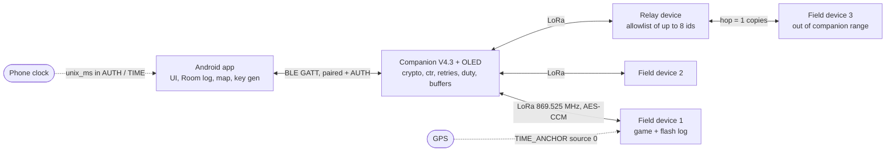

### 9.2 Network setup and companion pairing

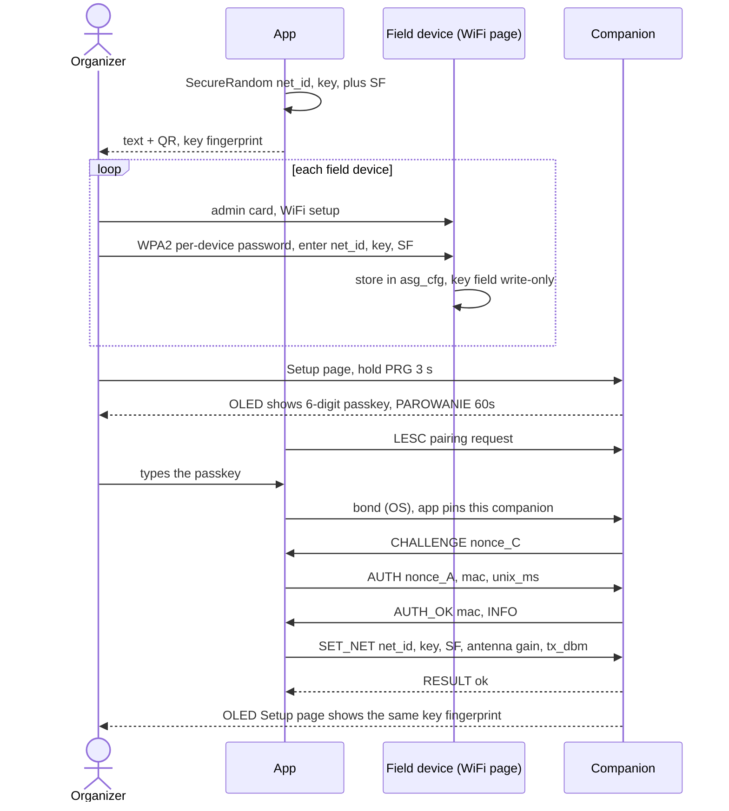

### 9.3 Pairing fallback: ECDH with a committed SAS

Used only if the P4 smoke test shows `trouble-host` cannot do LESC passkey pairing.

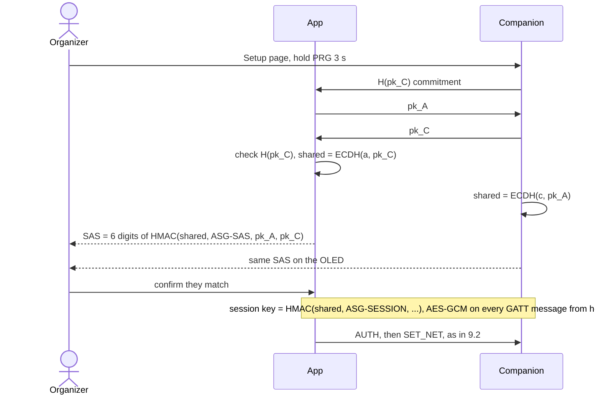

### 9.4 Every BLE connection: AUTH, time, SYNC

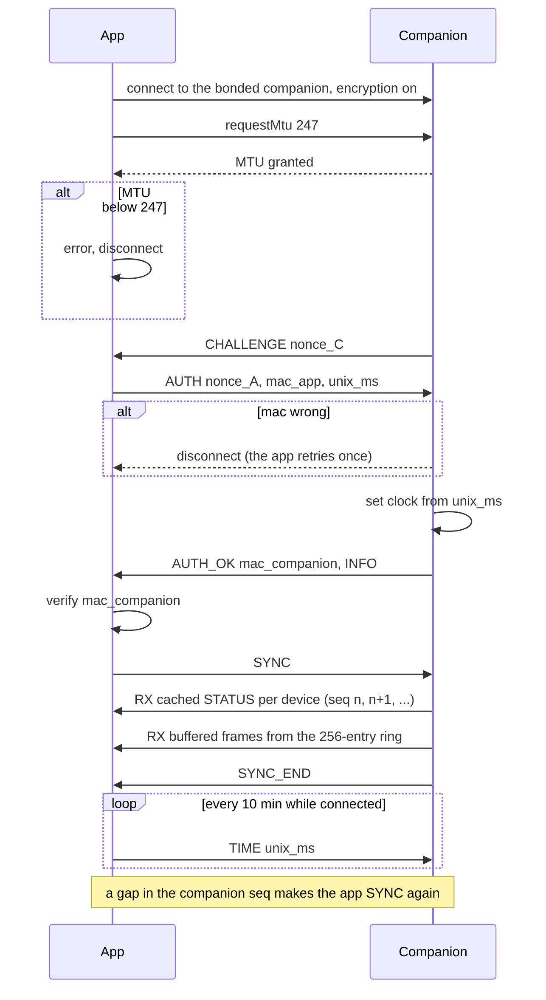

### 9.5 Game START with one deadline

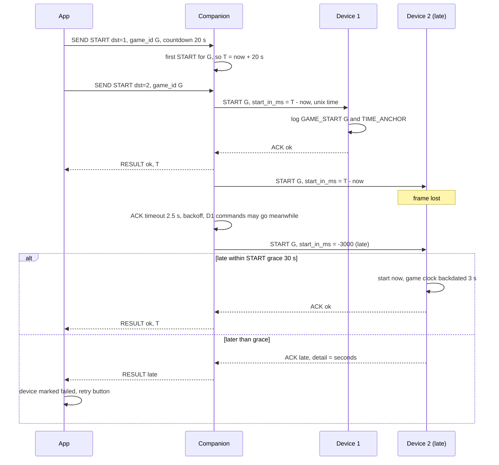

### 9.6 EVENT delivery: write first, then send, retry

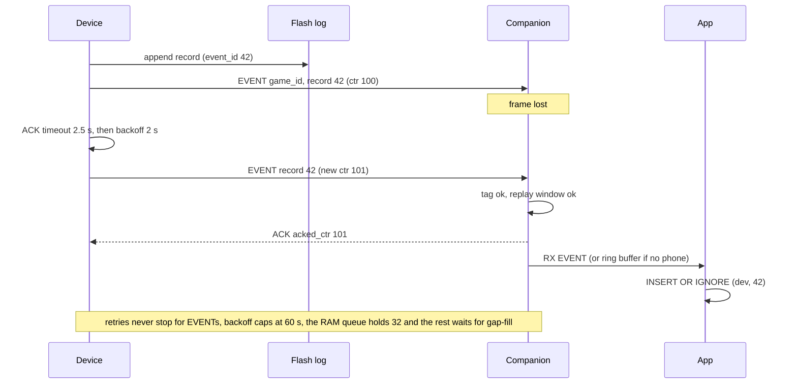

### 9.7 Relay forwarding

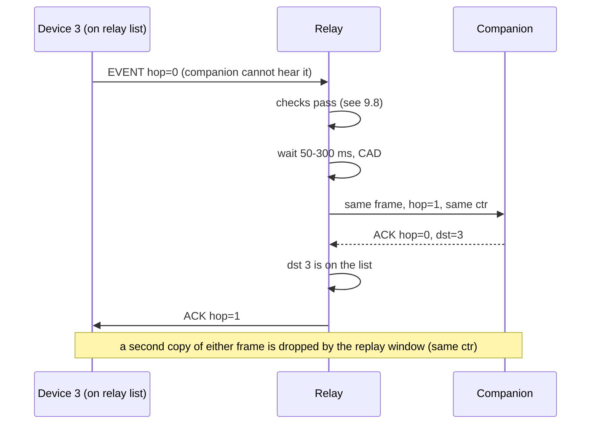

### 9.8 Relay decision

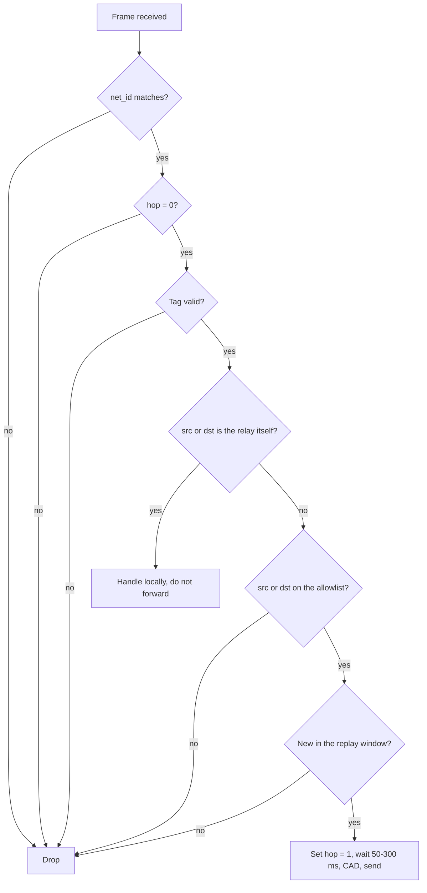

### 9.9 Transmit path on every node

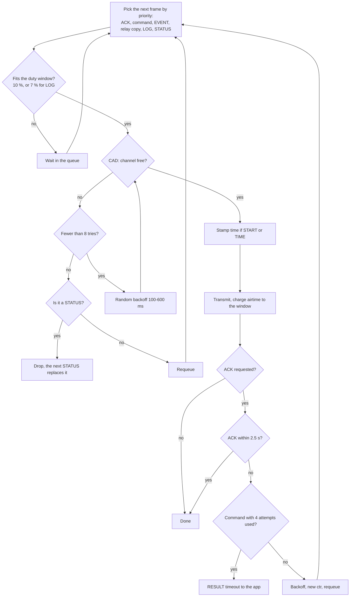

### 9.10 Gap-fill and full dump

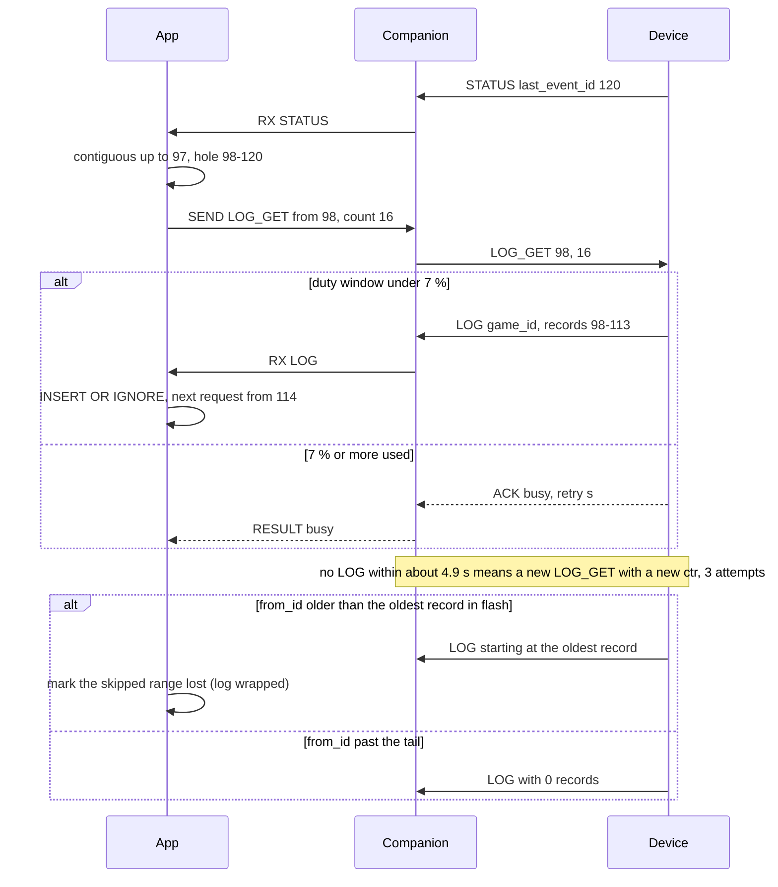

### 9.11 Time sync

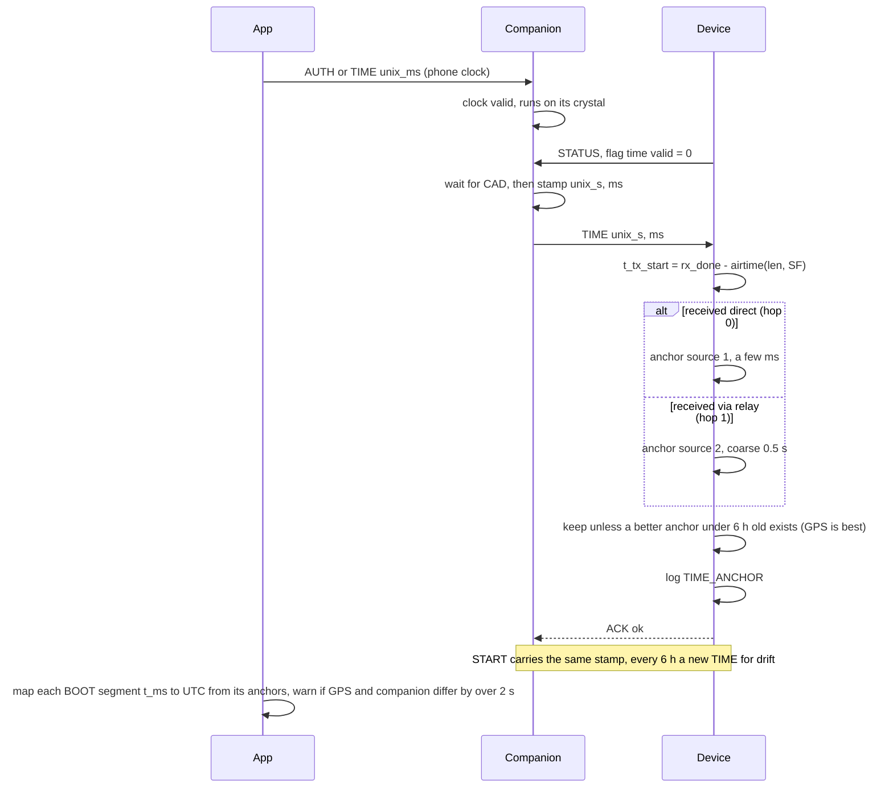

### 9.12 Device boot and reboot recovery

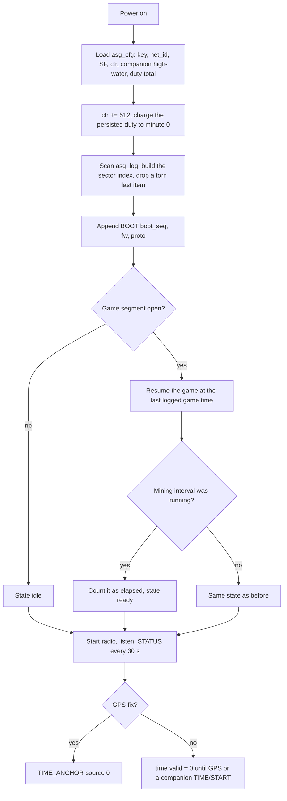

### 9.13 Device game states

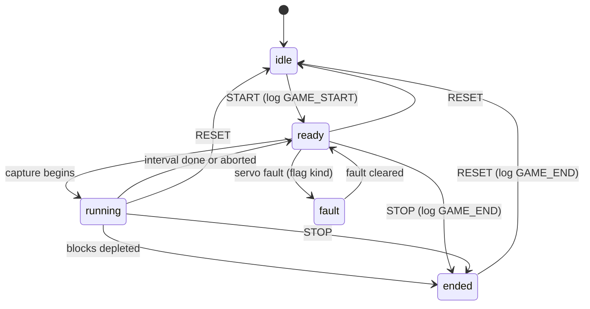

START for the running game is acknowledged with no change; START for a different `game_id` while a game
runs is answered `busy`.

### 9.14 Companion buttons and power

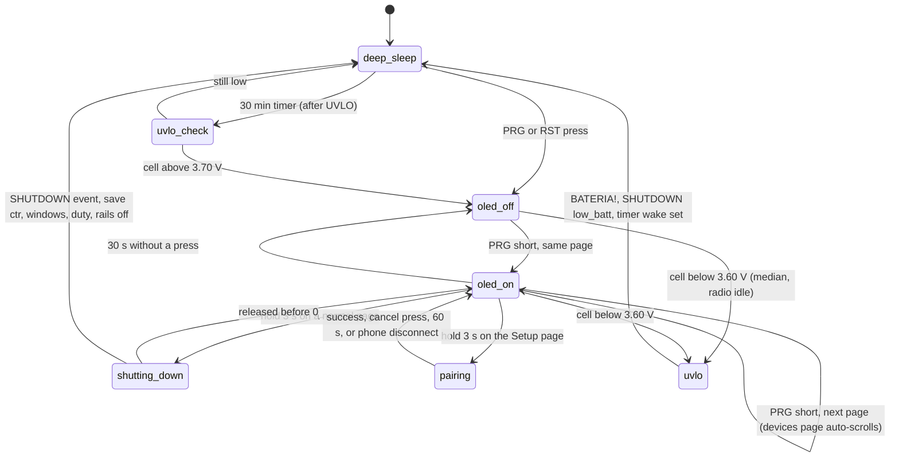

The key switch cuts the cell in any state (0 µA); RST reboots from any state.

### 9.15 Rekey

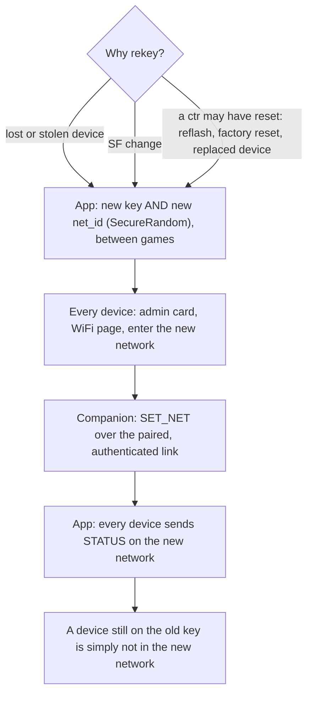

## Milestones (P2-28)

| | Milestone | Needs | Depends on |
|---|---|---|---|
| P1 | `asg_core::proto` + `docs/protocol.md` + vectors + simulation | nothing | — |
| P2 | Android app on `FakeCompanion` (all screens, Room, export, offline map) | nothing | P1 vectors |
| P3 | Field device radio task + flash log + partition table (replaces carrier milestone 4) | V4 | P1; carrier M2 (config storage). GPS fields stay 0 until carrier M5. Until carrier M6 (WiFi page), a `dev-key` build feature provides a development key, **never** in release builds |
| P4 | Companion firmware: stack bring-up + pair smoke test first, then LoRa bridge, BLE, OLED, buttons, power (replaces carrier milestone 7) | V4.3 with OLED | P1 |
| P5 | App ↔ real companion | phone + V4.3 | P2, P4; carrier M6 for real keys |
| P6 | Field test: relay, range, battery life | several V4s | P3-P5 |

**Stack bring-up (T2)** is its own first task in P3/P4, budgeted at a day: `esp-storage`,
`sequential-storage` + `embassy-embedded-hal`, `lora-phy`, `trouble-host`, `ssd1306`, `ccm` / `aes` /
`hmac` / `sha2` (+ `p256` / `aes-gcm` only for the fallback). None of these is in the tree yet; the
"stack" table of the carrier design is a plan, not code.

**Partition table (T5):** `partitions.csv` with app ≥ 2 MB (factory 3 MB), `asg_log` 384 KB, `asg_cfg`
16 KB; the firmware reads the ranges from the table at boot.

## Open items

- Bench: the PCM of the AKU-06034 (present, short trip), its fit in the case, key switch rating or
  1 A hot-switch test.
- `trouble-host` 0.7 pairing smoke test (decides primary vs fallback BLE security).
- `sequential-storage` queue: iterate without pop, mock flash for tests.
- Companion antenna part and gain.
- Measure: companion current (as-shipped and optimized), BLE share, OLED, flash stalls.

## Appendix: enums (moves to `docs/protocol.md` in P1)

Protocol version 1. Values not listed are reserved; a receiver ignores an unknown `type` and answers
`ACK{unknown_type}` if the ACK bit is set.

| `type` | Class | Direction |
|---|---|---|
| 0x01 | STATUS | device → companion |
| 0x02 | EVENT | device → companion |
| 0x03 | ACK | both |
| 0x04 | LOG | device → companion |
| 0x05 | CONFIG | both (companion: write; device: read-back reply) |
| 0x10 | PING | companion → device |
| 0x11 | START | companion → device |
| 0x12 | STOP | companion → device |
| 0x13 | RESET | companion → device |
| 0x14 | FLAG | companion → device |
| 0x15 | LOG_GET | companion → device |
| 0x16 | CONFIG_GET | companion → device |
| 0x17 | TIME | companion → device |

ACK bit (0x80): set on EVENT and every companion → device class; never on STATUS, ACK, LOG or
CONFIG replies (LOG and CONFIG replies are themselves the answer).

| `ACK.result` | `detail` |
|---|---|
| 0 ok | 0 |
| 1 busy | retry seconds |
| 2 bad_param | first unknown `param_id` |
| 3 unknown_type | the type |
| 4 late | seconds late (START beyond grace) |

| `state` | Airsoftcoin (`game.rs`) | Flag |
|---|---|---|
| 0 idle | no game / after RESET | no game |
| 1 ready | `Intro`, `Ready` | holding, nobody capturing |
| 2 running | `Mining` | capture in progress |
| 3 ended | `Depleted`, after STOP | after STOP |
| 4 fault | — | servo fault (`NO SERVO`, `JAM`, …) |

| `flags` bit | Meaning |
|---|---|
| 0 | relay on |
| 1 | GPS fix |
| 2 | low battery |
| 3 | fault (details in the kind tail) |
| 4 | FLAG override active |
| 5 | config changed since boot |
| 6 | time valid (an anchor taken in this boot) |

| `event` | Name | `team` / `player` / `extra` |
|---|---|---|
| 0x01 | BOOT | — / — / `boot_seq u16, fw_ver u8, proto_ver u8` |
| 0x02 | TIME_ANCHOR | source (0 GPS, 1 direct, 2 via relay) / ms 0-999 / `unix_s u32` |
| 0x03 | GAME_START | — / — / `game_id u16, mode u8, flags u8` |
| 0x04 | GAME_END | — / — / `game_id u16, reason u8 (0 STOP, 1 RESET), 0` |
| 0x05 | CONFIG_SET | — / — / `param_id u8, 0, value i16` (low 16 bits; the full value via `CONFIG_GET`) |
| 0x06 | LOW_BATT | — / — / `batt_mV u16, 0, 0` |
| 0x07 | SHUTDOWN | — / — / `reason u8 (0 user, 1 low_batt), 0, 0, 0` |
| 0x08 | ADMIN | — / — / `action u8, 0, 0, 0` |
| 0x09 | FAULT | — / — / `kind-specific code u8, 0, 0, 0` |
| 0x20 | CAPTURE | team / player id (0 = button) / 0 |
| 0x21 | BLOCK_MINED | team / player / `left u16, 0, 0` |
| 0x30 | FLAG_MOVED | team (or neutral) / 0 / `pos u8, cause u8 (0 game, 1 FLAG override), 0, 0` |

Kind-specific events start at 0x20; 0x20-0x2F Airsoftcoin, 0x30-0x3F flag. `team`: 0 none, 1 red,
2 blue, 3 neutral. `kind`: 1 counter (Airsoftcoin), 2 flag.
